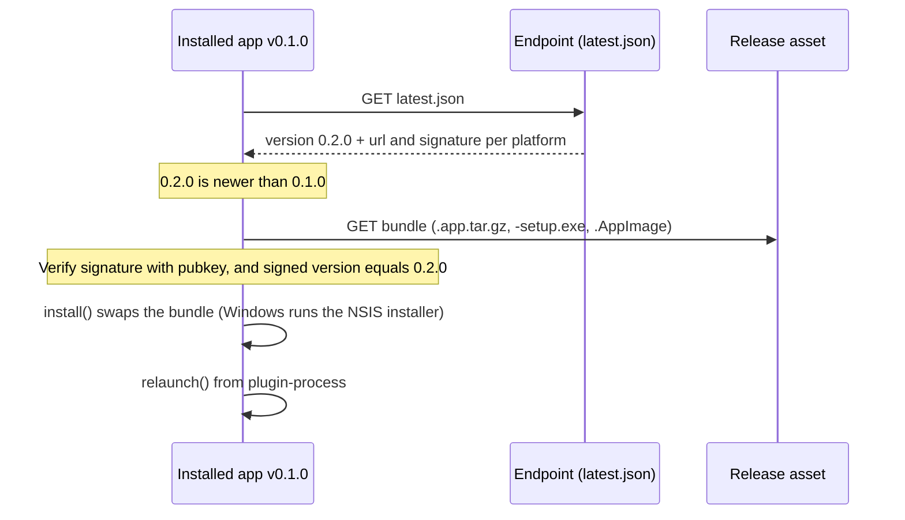

# Tauri v2 App Updater Demo

A small Tauri v2 desktop app for verifying the [updater plugin](https://v2.tauri.app/plugin/updater/)
end to end. It shows the running version, checks for updates, downloads them with a progress bar,
verifies the signature, installs the update and relaunches. Each version gets its own header
color, so you can see at a glance that an update happened.

There are two ways to verify it:

- **Locally**, against a tiny update server on `http://localhost:8787`. On macOS a single
  command builds two versions and proves the old one updates itself to the new one.
- **For real**, with GitHub Actions publishing signed releases plus `latest.json` to GitHub Releases.

## What's in here

| Path | Purpose |
|---|---|
| `src-tauri/tauri.conf.json` | Production updater config: public key, GitHub Releases endpoint, `createUpdaterArtifacts`, `requireSignedVersion` |
| `src-tauri/tauri.local.conf.json` | Overlay merged at build time (`--config`) that points the endpoint at `http://localhost:8787` |
| `src-tauri/src/lib.rs` | Registers the updater and process plugins, plus `demo_info` / `append_log` commands for the UI |
| `src-tauri/capabilities/` | Grants `updater:default` (desktop only) and `process:default` (for `relaunch()`) |
| `src/main.ts` | The check → download → install → relaunch flow, using the JS API |
| `scripts/demo.mjs` | Helpers: key generation, version bump, local build/publish/serve, end-to-end test |
| `.github/workflows/release.yml` | Tag-triggered build, sign and publish for macOS (arm64 + x64), Windows and Linux |

## Prerequisites

- Node.js 18+ and Rust stable (the updater plugin needs Rust 1.90 or newer)
- The [Tauri system prerequisites](https://v2.tauri.app/start/prerequisites/) for your OS
- The `gh` CLI, only for the GitHub deployment

```sh
npm install
```

## 1. Generate the signing keys

Every update must be signed. The app has the **public** key compiled in and refuses any update
that the matching **private** key did not sign. You can't turn this off.

```sh
npm run keys
```

This command:

1. Runs `tauri signer generate -w ~/.tauri/tauri-app-updater.key`, which asks for a password.
   A password is recommended. Press Enter to skip it, or run `npm run keys -- --no-password`.
2. Copies the contents of `~/.tauri/tauri-app-updater.key.pub` into `plugins.updater.pubkey` in
   `src-tauri/tauri.conf.json`.

If the key already exists it is reused. Use `--path FILE` to choose a different location and
`--force` to replace an existing key.

To do the same by hand:

```sh
npx tauri signer generate -w ~/.tauri/tauri-app-updater.key
# Then paste the CONTENTS (not the path) of ~/.tauri/tauri-app-updater.key.pub
# into plugins.updater.pubkey in src-tauri/tauri.conf.json
```

> [!IMPORTANT]
> Back up `~/.tauri/tauri-app-updater.key` and its password. If you lose either one, installed
> copies of the app can never be updated again, because they only trust this key. Never commit the
> private key. Committing the public key (in `tauri.conf.json`) is safe.

Signing happens during `tauri build` and is controlled by environment variables. `.env` files
are **not** read:

```sh
export TAURI_SIGNING_PRIVATE_KEY=~/.tauri/tauri-app-updater.key   # a path or the key content
export TAURI_SIGNING_PRIVATE_KEY_PASSWORD='your-password'          # leave unset if no password
```

The `local:*` scripts fall back to `~/.tauri/tauri-app-updater.key`, or to the demo key below,
when `TAURI_SIGNING_PRIVATE_KEY` is not set. For your own key, always export the password before
building; don't count on a prompt.

### Demo key pair committed to this repository

For test/demo use, the key pair whose public key is in `tauri.conf.json` is committed under
`.tauri/`:

| File | Contents |
|---|---|
| `.tauri/tauri-app-updater.key.test` | Private key (password-protected) |
| `.tauri/tauri-app-updater.key.pub.test` | Public key (same as `plugins.updater.pubkey`) |
| `.tauri/tauri-app-updater.key.pass` | The private key's password |

When no key is exported, the `local:*` scripts use these files, including the password, so
`npm run local:e2e` works right after cloning.

> [!WARNING]
> With the private key and its password public, **anyone can sign an update that this app
> accepts**. All that still protects installed copies is who can publish a release in the
> repository, plus HTTPS. That is acceptable for a demo only. For a real app, run
> `npm run keys -- --force` to make a new private key, delete `.tauri/`, update the
> `TAURI_SIGNING_PRIVATE_KEY*` Actions secrets, and ship a release signed with the old key that
> carries the new public key. The `.test` suffix keeps the `*.key` ignore rule working for every
> other key.

## 2. Verify locally

### Automated end-to-end test (macOS)

```sh
npm run local:e2e
```

This takes about 3 minutes, mostly for two release builds. It:

1. builds **v0.1.0** against the local endpoint and copies it to `.local/e2e/`
2. builds **v0.1.1** and publishes it to `.local/update-server/` (the bundle plus `latest.json`)
3. starts the update server and launches the old app with `--auto-update`
4. passes only if every check below passes, observed from the server's request log and from the
   bundle's `Info.plist` on disk:

```text
==> 5/5 Launch v0.1.0 with --auto-update and watch the update happen
7:04:05 PM GET /latest.json  <- app v0.1.0 (darwin-aarch64)  200 1280 bytes
7:04:05 PM GET /v0.1.1/Tauri Updater Demo.app.tar.gz  200 2751632 bytes
    ✓ v0.1.0 requested latest.json
    ✓ v0.1.0 downloaded the v0.1.1 bundle
    ✓ bundle on disk now reports v0.1.1
7:04:07 PM GET /latest.json  <- app v0.1.1 (darwin-aarch64)  200 1280 bytes
    ✓ relaunched app (v0.1.1) checked again and found no newer version

PASS the updater moved .local/e2e/Tauri Updater Demo.app from v0.1.0 to v0.1.1 and relaunched it.
```

Options: `npm run local:e2e -- --from 0.1.0 --to 0.2.0 --timeout 180`. At the end the script
prints the app's own log, which lives at
`~/Library/Logs/com.lifuzu.tauri-app-updater/updater-demo.log`.

The e2e runs its update server only while the test is going. Afterwards the bundle in
`src-tauri/target/release/bundle/macos/` is the **new** version, and nothing answers on port
8787. Opening that bundle and clicking Check fails with `error sending request`, and even with
`npm run local:serve` running it reports "latest version". To click through an update yourself,
use the manual steps below.

### Manual test (any desktop OS, through the UI)

For a step-by-step checklist with the expected result of every step, see
[VERIFICATION.md](VERIFICATION.md).

```sh
# Build the "old" version and install it somewhere the updater can replace it
npm run local:build -- --version 0.1.0
npm run local:install     # macOS/Linux: copies it to .local/installed/
                          # Windows: prints the setup.exe path; run it now

# Build the "new" version and publish it to the local update server
npm run local:build -- --version 0.2.0
npm run local:publish -- --notes "Hello from 0.2.0"

# In a second terminal: serve .local/update-server and log every request
npm run local:serve
```

Open the installed app (on macOS: `open ".local/installed/Tauri Updater Demo.app"`) and click
**Check → Download → Install → Restart**. After the restart the app shows v0.2.0 in a new color.

Notes:

- `--version` only overrides the version for that one build (through an inline `--config`).
  It doesn't edit any files.
- The local endpoint uses plain HTTP, so `tauri.local.conf.json` sets
  `dangerousInsecureTransportProtocol`. Without it, release builds reject non-HTTPS endpoints.
  Never ship that overlay.
- `npm run tauri dev` is fine for **checking** only, and the app disables Download and Install
  there. On macOS the updater works out the install location from the executable path, which
  under `tauri dev` is `src-tauri/target/debug/`. Installing would replace that whole directory.

### Try to break it

These tampering experiments show the security checks are real. All three were checked on macOS
against an installed build:

| Tamper with | What the app reports |
|---|---|
| `version` in `.local/update-server/latest.json`, e.g. announce `0.2.1` for the 0.2.0 bundle | `The update was signed for version 0.2.0 but the update endpoint announced version 0.2.1…`, from `requireSignedVersion` |
| One byte of the bundle under `.local/update-server/v*/` | `The signature verification failed` |
| Delete `latest.json` | The server answers `204 No Content` and the app says it is on the latest version |

## 3. Deploy with GitHub Releases

The production endpoint in `tauri.conf.json` is:

```text
https://github.com/lifuzu/tauri-app-updater/releases/latest/download/latest.json
```

GitHub redirects `releases/latest/download/<file>` to that file in the newest **published**
release (drafts and pre-releases are skipped). So each release becomes the update the moment it
is published.

**One-time setup.** Run these from this directory, after `npm run keys`:

```sh
# 1. Point the endpoint at your repository (skip if lifuzu/tauri-app-updater is right).
#    The repository must be PUBLIC: the updater downloads without credentials.
npm run set-repo -- <owner>/<repo>

# 2. Create the repository and push
git init && git add -A && git commit -m "Tauri updater demo"
gh repo create <owner>/<repo> --public --source . --remote origin --push

# 3. Store the private key (and password) as Actions secrets
gh secret set TAURI_SIGNING_PRIVATE_KEY < ~/.tauri/tauri-app-updater.key
gh secret set TAURI_SIGNING_PRIVATE_KEY_PASSWORD     # paste the password; skip if none
```

**Release v0.1.0**, the version you install first:

```sh
git tag v0.1.0 && git push origin v0.1.0
```

`.github/workflows/release.yml` then:

1. checks that the tag matches the `version` in `tauri.conf.json`, that the public key is set and
   that the signing secret exists
2. creates a **draft** release and builds macOS (Apple Silicon and Intel), Linux and Windows.
   Each job uploads its installer, updater bundle and `.sig`, and merges its platform into the
   release's `latest.json` (that part is done by `tauri-apps/tauri-action`)
3. publishes the draft once every platform has succeeded, so all platforms switch to the new
   version at the same moment

Install v0.1.0 from the release page (`.dmg`, `-setup.exe` or `.msi`, `.AppImage` or `.deb`).

**Release v0.2.0** and watch the installed app update:

```sh
npm run set-version -- 0.2.0          # tauri.conf.json, package.json, Cargo.toml
git commit -am "Release v0.2.0"
git tag v0.2.0 && git push origin HEAD v0.2.0
```

When the workflow is green, open the installed app and click **Check**. It should offer 0.2.0,
then download, install and relaunch. To see exactly what the app will receive:

```sh
curl -sL https://github.com/<owner>/<repo>/releases/latest/download/latest.json \
  | jq '{version, notes, platforms: (.platforms | keys)}'
```

> [!NOTE]
> **macOS Gatekeeper.** The app is only ad-hoc signed (`bundle.macOS.signingIdentity: "-"`). It
> is not signed with an Apple Developer ID and not notarized, so macOS refuses to open a copy
> downloaded in a browser. For this demo, clear the quarantine flag after copying the app to
> /Applications:
> `xattr -dr com.apple.quarantine "/Applications/Tauri Updater Demo.app"`. Bundles installed by
> the updater are written by the app itself and don't get the flag. For real distribution, set up
> [Developer ID signing and notarization](https://v2.tauri.app/distribute/sign/macos/). Windows
> SmartScreen warns about unsigned installers in the same way.

## Things to know

- **Don't install from `tauri dev`.** In that mode the updater would replace the whole
  `src-tauri/target/debug/` folder, because it works out the install location from the
  executable's path. The app detects this and disables Download and Install there; checking
  still works.
- **Signed versions are enforced.** `tauri add updater` turned on `requireSignedVersion`, and I
  left it on. An update is rejected unless its signature records the same version
  `latest.json` announces. If you ever sign by hand with `tauri signer sign`, pass
  `--app-version`.
- **macOS will block the first download.** The app is ad-hoc signed only, so after downloading
  from the release page you need
  `xattr -dr com.apple.quarantine "/Applications/Tauri Updater Demo.app"`. Updates installed by
  the updater don't have this problem.

## How it works



The configuration that matters:

| Setting | Meaning |
|---|---|
| `bundle.createUpdaterArtifacts: true` | `tauri build` also produces the updater bundle and its `.sig`. On macOS that is `.app.tar.gz`. On Windows and Linux the installer or AppImage itself is reused. |
| `plugins.updater.pubkey` | The public key **contents**. It is compiled into the app. |
| `plugins.updater.endpoints` | Tried in order. They may contain `{{current_version}}`, `{{target}}`, `{{arch}}` and `{{bundle_type}}`; the local overlay uses them so the server log shows which version is asking. |
| `plugins.updater.requireSignedVersion: true` | Rejects an update unless its signature records the same version that `latest.json` announces. This stops a tampered `latest.json` from passing off an older, validly signed build as a new version. Signatures made by hand with `tauri signer sign` need `--app-version`. |
| `plugins.updater.windows.installMode: "passive"` | Windows shows a progress bar and needs no clicks. `install()` closes the app first. |

A `latest.json` looks like this one, which `npm run local:publish` wrote. tauri-action uploads
the same shape, with GitHub asset URLs. The `signature` value is the **contents** of the `.sig`
file. Keys can be `{os}-{arch}` or the more specific `{os}-{arch}-{installer}`:

```json
{
  "version": "0.2.0",
  "notes": "Hello from 0.2.0",
  "pub_date": "2026-10-10T02:04:00.000Z",
  "platforms": {
    "darwin-aarch64": {
      "signature": "dW50cnVzdGVkIGNvbW1lbnQ6IHNpZ25hdHVyZSBmcm9tIHRhdXJpIHNlY3JldCBrZXkK...",
      "url": "http://localhost:8787/v0.2.0/Tauri%20Updater%20Demo.app.tar.gz"
    },
    "darwin-aarch64-app": {
      "signature": "dW50cnVzdGVkIGNvbW1lbnQ6IHNpZ25hdHVyZSBmcm9tIHRhdXJpIHNlY3JldCBrZXkK...",
      "url": "http://localhost:8787/v0.2.0/Tauri%20Updater%20Demo.app.tar.gz"
    }
  }
}
```

## Troubleshooting

| Symptom | Cause and fix |
|---|---|
| Build: `A public key has been found, but no private key` | `TAURI_SIGNING_PRIVATE_KEY` isn't exported in that shell, or the CI secret is missing |
| Build: `incorrect updater private key password` | Export `TAURI_SIGNING_PRIVATE_KEY_PASSWORD` |
| Build: `failed to read plugin permissions: ... No such file or directory`, naming an old path | The project was moved or copied along with `src-tauri/target`. Cargo caches absolute paths in it, so run `(cd src-tauri && cargo clean)` once. The `local:*` scripts detect this. |
| Build: `The updater secret key from TAURI_SIGNING_PRIVATE_KEY does not match the public key` | `pubkey` in `tauri.conf.json` belongs to another key. Run `npm run keys` to sync it (the `local:*` scripts check this before building). |
| App: `The signature verification failed` | The release was signed with a key that doesn't match the `pubkey` inside the installed app. Copies installed with the old key can't be fixed, so reinstall them. |
| App: `error sending request for url (http://localhost:8787/...)` | Nothing is listening on port 8787. Builds made by `local:build` or `local:e2e` check the local server, and the e2e stops its server when it finishes. Start it with `npm run local:serve`. |
| App: `Could not fetch a valid release JSON from the remote` | The endpoint is unreachable or doesn't return JSON. On GitHub: nothing published yet, the release is still a draft, or the repo is private. |
| App: check finds nothing although you released | The release version isn't higher than the installed one, or it is still a draft or pre-release |
| App: `the platform ... was not found in the response platforms object` | `latest.json` has no entry for your `{os}-{arch}`, for example because that matrix job failed |
| App: `The configured updater endpoint must use a secure protocol` | Release builds need HTTPS endpoints. Only the local overlay allows HTTP. |
| Workflow: `Resource not accessible by integration` | Repo Settings → Actions → General → Workflow permissions → **Read and write** |
